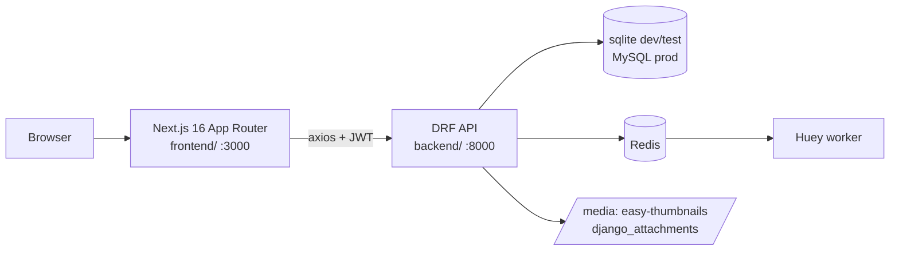
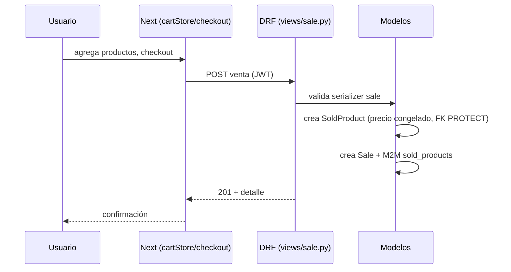
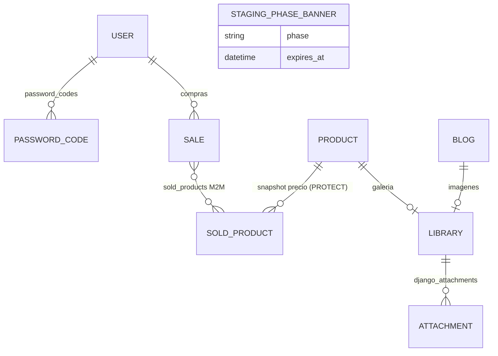
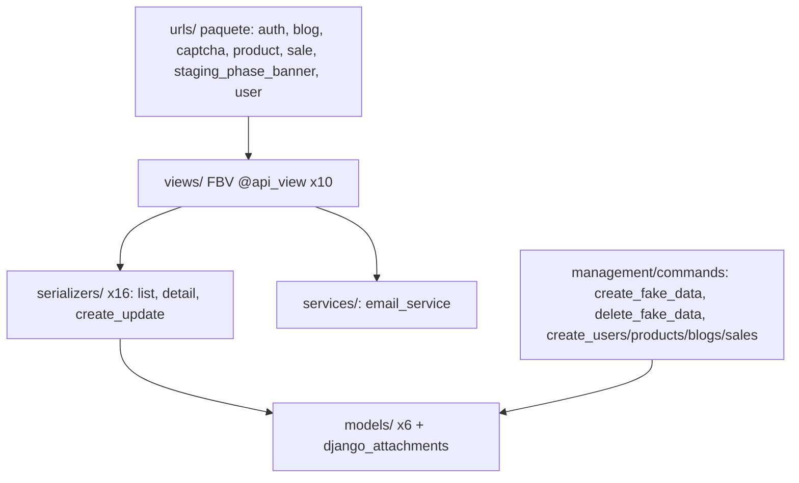
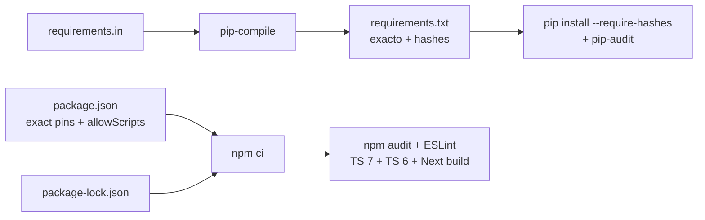

# Architecture — Base Django React Next Feature

> Memory Bank · actualizado 2026-10-11 (contratos backend/tooling de ronda 5). El pipeline de CI conserva su configuración existente.

## Vista de sistema

- Frontend consume `api/*`; auth por JWT (`/api/token/` + refresh) guardado vía `lib/services/tokens`.
- `api/health/` identifica proyecto+entorno (verificación de probes del fleet).

## Flujo de request típico (compra)

## Modelo de datos (ER)

Modelos en `backend/base_feature_app/models/` (6): `user.py` (custom User + manager), `password_code.py`, `product.py`, `blog.py`, `sale.py` (Sale + SoldProduct), `staging_phase_banner.py`; más `django_attachments/models.py` (Library/Attachment).

## Capas backend

## Frontend (App Router)

- 12 páginas: `/`, `catalog`, `products/[productId]`, `blogs`, `blogs/[blogId]`, `checkout`, `sign-in`, `sign-up`, `forgot-password`, `admin-login`, `dashboard`, `backoffice` (+ `manual`).
- 6 stores Zustand (`lib/stores/`): auth, blog, cart, locale, product, stagingBanner. 2 hooks compartidos (`useRequireAuth`, `useHydrated`).
- 30 componentes/páginas `.tsx` entre `app/` y `components/` sin contar tests (48 incluyendo `__tests__/`); incluye `components/staging/` con el banner de fase.

## Contratos backend y workflow de pruebas (ronda 5)

- Google: `views/auth.py` valida el token con Google, exige cliente/audiencia configurados y email verificado; identidad y nombres proceden exclusivamente del payload. DEBUG no habilita autenticación con identidad del request. Snapshot: `14796e538d85ee845a82ebf8eea8acf6b398d27a`.
- Adjuntos: `pre_save` captura el descriptor anterior; `post_save` agenda limpieza solo si el guardado tuvo éxito; `post_delete` agenda el borrado. `on_commit` usa el alias de la operación y descarta callbacks de rollback/savepoint. `Attachment` queda excluido de `django_cleanup`, con un único dueño de limpieza que protege referencias en ese mismo alias. Los fallos de limpieza posteriores al commit no deshacen la DB ni interrumpen callbacks posteriores; logs solo incluyen operación y clase. Reattachment concurrente y archivos compartidos entre aliases quedan fuera de la garantía. Snapshot: `b286e2300410cf43375b14e2793eb15baa3663a3`.
- Runner: prepara argv ordenado, cwd resuelto y entorno efectivo antes de decidir resume, y ejecuta ese mismo entorno. Solo el SHA-256 del entorno se persiste. Identidad distinta/inválida o fallo anterior fuerzan ejecución; identidad coincidente no demuestra frescura de código, dependencias, datos o servicios. Snapshot: `2d97e9afc0d3a40c149fb781c8b9b63cb2059638`.
- Los autores son dueños de sus tests; QA conserva cuatro documentos y una única aceptación final sobre el combinado limpio. Backend y gate son las capas requeridas; no hay cambios frontend/mapa/config/migraciones. Los resultados del SHA final y CI quedan en artefactos ignorados/PRs, sin inferirse de las pruebas de autor.
- `django_attachments/tests.py` mantiene ubicación histórica fuera del AST gate. Se ejecuta explícitamente y recibe Ruff complementario base/nuevo: 15 hallazgos anteriores, cero nuevos; no equivale al gate semántico ni significa limpieza global. El validator del proyecto exige Ruff/ESLint y las tres capas; un gate focal backend es complemento.

Snapshot combinado de aplicación integrado sin conflictos: `ad5659eff890d827faf73f90a1b49a6bc39acbf6`; la aceptación final con documentación se acredita aparte. Contratos, IDs oficiales y evidencia de autor: `docs/audits/improvement-ronda5-20261011.md`. MySQL CI se mantiene diferido; SQLite no acredita los tres tests concurrentes de recuperación que requieren invocación explícita contra MySQL 8.4+.

## Deployment / CI (workflow actual)

- Template **sin despliegue**: sólo CI en GitHub Actions.
- `ci.yml`: backend-tests (lock drift + hashes + pip-audit + pytest sqlite) ·
  frontend-unit-tests (npm audit + scripts revisados + lint + TypeScript 7/6 +
  build + Jest) ·
  frontend-e2e-tests (venv + migrate + `create_fake_data 5` + Playwright
  chromium + flow-coverage reporter) · coverage-summary.
- `test-quality-gate.yml`: gate con `--junk-severity=error` contra `.junk-baseline.json`.
- Ramas protegidas: nunca commit directo a master; trabajo vía rama + PR.

## Supply chain de dependencias

- Runtimes compartidos por local y CI: Python 3.14.7 (`.python-version`) y
  Node 24.20.0 (`.nvmrc`); npm 11.19.0 se declara en `packageManager`.
- Las GitHub Actions están fijadas por SHA con el tag legible como comentario.
- Los scripts nativos npm sólo se autorizan por paquete y versión mediante
  `allowScripts`; un bump no hereda confianza automáticamente.

### Workflow actual (2026-08-27)

El dependency refresh integral quedó implementado secuencialmente en el PR #20:
cada commit funcional esperó backend, frontend unit, frontend E2E, quality gate
y coverage verdes antes del siguiente. El reporte canónico es
`audit-report.md`.
